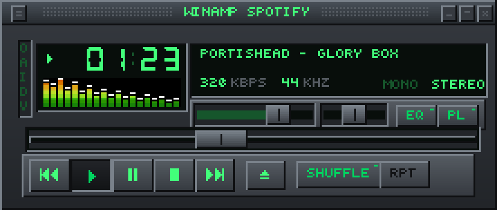
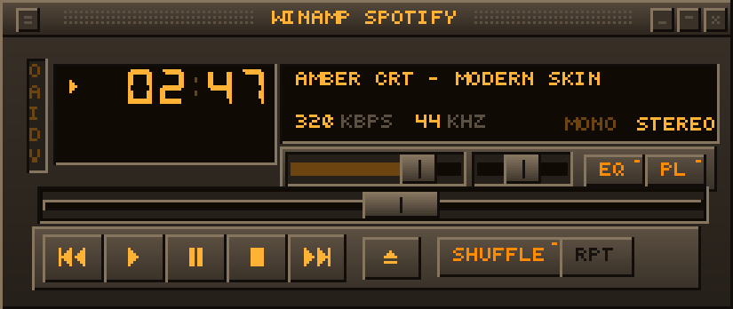
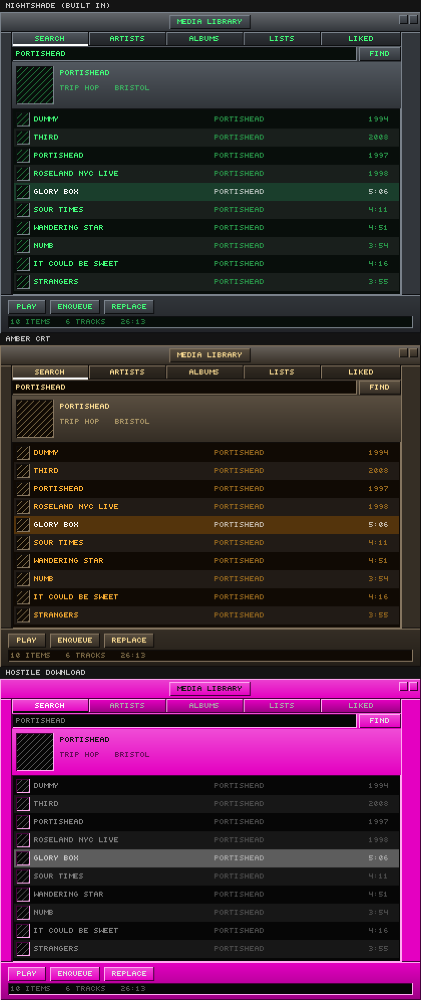

# Winamp Spotify

A skeuomorphic Spotify player for macOS, built to look and behave like Winamp 2:
a 275×116 borderless window, real `.wsz` skin support, a playlist editor, and a
spectrum analyzer reading Spotify's actual audio output.



*Built-in "Nightshade" skin, drawn in code — no third-party artwork is bundled.*



*"Amber CRT", the worked example of the modern `.wskin` format.*



*The media library, themed from three different skins. The third is a
deliberately hostile one — see [Theming a window no skin has art
for](#theming-a-window-no-skin-has-art-for).*

---

## What this is, and what it deliberately isn't

There is **no official Spotify playback SDK for macOS**. The Web Playback SDK
needs Widevine, which `WKWebView` does not have, so an app cannot become a
Spotify playback device natively. What it *can* do is drive Spotify — and that
turns out to be enough, because Winamp was always a controller with a great face.

So this app uses two backends and hides the difference:

| | Local | Remote |
|---|---|---|
| **Talks to** | Spotify.app on this Mac | Any Spotify Connect device |
| **How** | Apple events (ScriptingBridge) | Web API |
| **Needs Premium** | No, for transport | Yes |
| **Latency** | None | ~1s, position interpolated |
| **Position accuracy** | Sub-second, seekable | Polled |

Both implement `PlaybackEngine`, and `PlaybackCoordinator` picks whichever is
reachable. The Web API also supplies everything Apple events can't: your
playlists, liked songs, search, and artwork.

### There is no equalizer

This is the one place the app refuses to look like Winamp, and the reason is
worth stating plainly: **a process tap can read Spotify's audio but not change
it.** Real filtering would mean shipping a virtual audio device, asking you to
switch your system output to it, and adding latency — for a feature Spotify
already offers on iOS and in its own settings.

Ten sliders that move but do nothing would be a lie about what the app does, so
they are left out. The EQ button in the skin is kept (classic skins expect the
sprite) and repurposed to cycle the visualizer.

If you ever want the real thing, the seam is `AudioVis`: an output stage between
`ProcessTap` and the device would slot in there without touching the UI.

### Search, artists and albums

The **media library** window (eject button, or ⌘L) covers search, followed
artists, saved albums, playlists and liked songs, with drill-down: artist → top
tracks → full discography → album → tracks. Everything reduces to one row type,
so there is a single list renderer rather than five, and `PLAY` / `ENQUEUE` /
`REPLACE` act on whatever is currently listed.

It needs a Spotify client ID, because browsing is Web API work. Transport
control does not.

### Theming a window no skin has art for

This is the interesting problem. A classic `.wsz` contains sprites for exactly
three windows — main, equalizer, playlist. There is no `search-field.bmp`, no
tab strip, no artist row, and there never will be, because the format froze in
1997. So the library window cannot be blitted from a downloaded skin. A native
macOS panel next to a skinned player looks like two applications, which is the
thing worth avoiding.

The way out is that a classic skin still tells you enough to **derive** a
palette, and then the widgets get generated in those colours:

| Source in the skin | What it gives |
|---|---|
| `pledit.txt` | List text, now-playing text, background, selection background, and a `Font=` request. This is literally a list-view theme — and its `mbFG`/`mbBG` keys themed Winamp's old *minibrowser*, so using them for an in-app browser is what they were for. |
| `viscolor.txt` | A display well and an accent ramp, 24 colours. |
| `main.bmp` | The faceplate. Sampling the chrome bands — the strips between the controls, which are always faceplate and never a sunken display — recovers the base colour and the bevel pair the author drew with. |
| `pledit.bmp` | Corner and tile sprites that are a **general-purpose resizable window frame**, not playlist-specific. The library window is framed in the skin's own artwork. |
| `text.bmp` | The bitmap font, re-tinted for labels (see below). |

`SkinThemeDerivation` turns that into a `SkinTheme`; `ThemedChrome` draws
buttons, tabs, wells, scrollbars and artwork frames from it, in the same
bevel-and-recess idiom the original skins were built from. A modern `.wskin` can
declare a `theme` block to correct any of it, but never has to.

Three details that turned out to matter:

- **Contrast is enforced, not hoped for.** These colours were chosen to sit
  under sprites, not behind text, and plenty of skins set `Normal` barely
  distinguishable from `NormalBG`, or `SelectedBG` identical to it. Every
  text/surface pair is checked and pushed apart, keeping the hue where it can.
  The direction is found by trying both and taking the better worst case — a
  luminance threshold sends saturated colours the wrong way, since hot pink has
  a low relative luminance but takes *dark* text.
- **Panels are gradients**, so faceplate text is optimised against the whole
  tonal range it sits on rather than one end of it. Faceplate text is also a
  separate pair from display text, because a colour legible on a dark well can
  vanish on a bright faceplate.
- **The bitmap font is tinted.** `text.bmp` bakes the skin's colour in — right
  for the main window, invisible on a generated widget. Coverage is taken as
  distance from the sheet's background tone, which handles both dark-ink and
  light-ink sheets and keeps anti-aliased edges.

Two things are deliberately *not* themed. Album artwork is someone's cover, not
skin art, so it is framed in the skin's bevel instead. And the search field is a
real `NSTextField`, styled to match — hand-rolling text input means losing IME,
selection, paste and undo.

### The visualizer is real

The spectrum analyzer is **not** decorative. `ProcessTap` creates a Core Audio
process tap on Spotify (macOS 14.2+, with your permission), wraps it in a private
aggregate device, and runs the samples through a vDSP FFT. Nineteen log-spaced
bands, gravity-decay bars, peak caps, `viscolor.txt` palette — the real thing.

If the tap is unavailable — older macOS, permission declined, Spotify not yet
producing audio — the visualizer draws a **flat line**, not fake movement.

---

## Building

macOS 14.0 or later, Xcode 15 or later.

```bash
cd winamp-spotify
Scripts/build-app.sh          # → build/Winamp Spotify.app
open "build/Winamp Spotify.app"
```

Run the tests with `swift test`.

### Why a script and not an `.xcodeproj`

`Package.swift` is the single source of truth. For editing and debugging,
`open Package.swift` gives a full Xcode session over all five targets.

The script exists because SwiftPM emits a bare Mach-O and this app needs a real
bundle: macOS reads the Automation and audio-capture usage strings from
`Info.plist`, LaunchServices needs the registered `winamp-spotify://` scheme for
the OAuth redirect, and TCC remembers permission grants against a code
signature. The script assembles `Contents/`, copies the plist, and signs with
entitlements.

`Package.swift` also embeds `Info.plist` into the executable's `__TEXT` segment,
so even a plain `swift run` gets the permission prompts — handy when debugging
those paths.

Signing ad-hoc (the default) means macOS may re-prompt for permissions after a
rebuild. `SIGN_IDENTITY="Developer ID Application: …" Scripts/build-app.sh`
keeps the grants stable.

### Not sandboxed

The app sends Apple events, creates a Core Audio process tap and an aggregate
device, and loads skins from arbitrary paths. The sandbox permits no combination
of those, so distribution is a notarized DMG, not the Mac App Store.

---

## First run

1. **Automation prompt** — "Winamp Spotify wants to control Spotify". Required;
   this is how local playback works.
2. **Audio Recording prompt** — for the spectrum analyzer. Optional; decline and
   you get a flat line.
3. **Spotify client ID** (optional, for library browsing and remote devices):
   - Create an app at [developer.spotify.com/dashboard](https://developer.spotify.com/dashboard)
   - Add `winamp-spotify://auth` as a Redirect URI, **exactly**
   - Paste the Client ID into Preferences → Spotify, then Sign In

There is no client secret to configure: this uses Authorization Code + PKCE,
which is the only sanctioned flow for a native app. Tokens live in the keychain,
marked `ThisDeviceOnly`.

Transport control works with no client ID and no Premium at all.

---

## Using it

The window behaves the way you remember.

| | |
|---|---|
| Drag the chrome | Move the window |
| Double-click the title bar | Windowshade mode |
| Click the clock | Toggle elapsed / remaining |
| Click the visualizer | Cycle spectrum → oscilloscope → off |
| Scroll anywhere | Volume |
| Right-click | The options menu |
| Right-click **RPT** | Cycle off → repeat all → repeat one |
| **Eject** | Open the media library |
| **PL** | Playlist editor |
| ⌘D | Double size (also 3× and 4×) |

The playlist editor is a real one: multi-select with shift and command, arrow
keys, delete, sort by title/artist/album, randomize, save and load, export as
`.m3u8` with `spotify:` URIs that Spotify's own app will import.

---

## Skins

Drop skins into `~/Library/Application Support/WinampSpotify/Skins`, or use
Preferences → Skins → Add Skin. Both formats are supported, and both resolve to
the same `Skin` value, so the renderer never knows which it got.

### Classic `.wsz` / `.wsp`

Thousands of existing Winamp 2 skins load as-is. The loader handles what those
archives actually contain, not just what the spec says:

- Sprite sheets matched **by basename, case-insensitively** — skins have been
  shipping `MAIN.BMP`, `Main.bmp` and `main.bmp` interchangeably since 1997, and
  many are packed inside a wrapper folder.
- **Partial skins are normal.** A skin that only replaces `main.bmp` is valid;
  anything missing is filled in from the built-in skin via `Skin.merged(over:)`.
- A hand-rolled **BMP decoder** as a fallback: ImageIO rejects a surprising
  number of skin bitmaps (OS/2 core headers, top-down rows, under-declared
  palettes) that Winamp itself loaded fine.
- `pledit.txt` colours, `viscolor.txt` palettes, `region.txt` window shapes
  (applied as a real layer mask, so notched skins really are notched).
- Unpacked skin folders work too.

Not supported: `.wal` modern Winamp 5 skins, which are a completely different,
XML-driven format.

### Modern `.wskin`

A zip (or folder) with a `skin.json` and PNG sheets. It exists because the
classic format is a straitjacket — fixed 275×116 geometry, 1× art, sprite
rectangles frozen since 1997. Here the skin declares its own rectangles and,
optionally, its own layout:

```jsonc
{
  "format": "winamp-spotify-skin",
  "version": 1,
  "name": "Amber CRT",
  "assetScale": 1,              // asset pixels per layout pixel; 2 for retina art
  "sheets": { "main": "sheet.png" },
  "sprites": {
    "MAIN_BACKGROUND": { "sheet": "main", "x": 0, "y": 0, "width": 275, "height": 116 },
    "BUTTON_PLAY":     { "sheet": "main", "x": 280, "y": 0, "width": 23, "height": 18 }
  },
  "strips": {
    // A run of frames: 28 volume states, 15px apart vertically.
    "VOLUME_BACKGROUND": { "sheet": "main", "x": 0, "y": 200,
                           "width": 68, "height": 13, "count": 28, "stepY": 13 },
    // Or a grid: the bitmap font, 31 glyphs per row.
    "FONT":              { "sheet": "main", "x": 0, "y": 600,
                           "width": 5, "height": 6, "count": 93, "columns": 31 }
  },
  "playlist": { "normalText": "#FFB234", "background": "#100A04" },
  "visualizerColors": ["#100A04", "#302418", "..."],   // 24, viscolor.txt order
  "layout": { /* optional: override any control's position */ },
  "regions": { "normal": [[3,0, 272,0, 275,3, /* … */]] }
}
```

Sprite names are the `SpriteID` raw values; strip names are `SpriteStripID`.
Everything except `name` and `sheets` is optional.

`Skins/Amber CRT.wskin` is a complete worked example — all 74 sprites, all four
strips, custom palettes, rounded-corner regions. It is generated by
`Tools/make_example_skin.py`, so that script also doubles as documentation of
the format.

---

## Layout

```
Sources/
  SkinKit/       Skin parsing and sprite resolution. No AppKit — so an
                 iOS/iPadOS variant can reuse it unchanged.
    ZipArchive          Central-directory parser + Compression inflate
    BMPDecoder          1/4/8/24/32-bit BMP, the forgiving kind
    RasterImage         RGBA8 buffers, cropping, chroma keying
    ClassicSpriteTable  Where every sprite lives in a .wsz's sheets
    Geometry            PixelRect, LayoutSlot, SkinLayout.classic
    ClassicSkinLoader   .wsz → Skin
    ModernSkinLoader    .wskin → Skin
    DefaultSkin         The built-in skin, drawn procedurally
    SkinLibrary         Discovery, caching, base-skin merging
    SkinTheme           Palette for windows with no sprites, + colour maths
    SkinThemeDerivation Reading that palette out of any skin
    ThemedChrome        Generating widget art from it

  SpotifyKit/    Web API. OAuth PKCE, keychain tokens, typed endpoints —
                 including artist, album, discography and multi-type search.
  PlayerCore/    PlayerSnapshot, the PlaybackEngine protocol, the remote
                 engine, Playlist, PlaybackCoordinator, and MediaBrowser
                 (the library's navigation stack).
  AudioVis/      Core Audio process tap + vDSP FFT.
  WinampSpotify/ The app: AppKit windows, sprite renderer, ScriptingBridge.
    SkinnedFrame        One resizable window frame, shared by the playlist
                        and library windows
    ThemedText          Bitmap font or the skin's requested system font
    MediaLibraryView    The drawn browser
```

The split that matters: **views know pixels, the coordinator knows playback, and
the controller knows what a click means.** That is what makes the skin swappable
and the backend interchangeable.

### iOS / iPadOS

`SkinKit` and `SpotifyKit` are already platform-agnostic, and `PlayerCore` needs
only a new engine. The pieces that would change:

- **Playback**: the Spotify iOS SDK's App Remote, which remote-controls the
  installed Spotify app. That is the only sanctioned route on iOS.
- **No visualizer**: iOS has no equivalent of a process tap. The honest move is
  to omit it, as with the equalizer here.
- **Rendering**: `SkinRenderer` and the two views are AppKit and would need
  UIKit counterparts — but they talk to `Skin` and `PlayerSnapshot`, not to
  Spotify, so it is a re-skin of the view layer rather than a rewrite.

---

## Status

Written on Linux and **not yet compiled** — there is no Swift toolchain for
macOS frameworks here. Expect to fix compile errors on the first build.

What *has* been verified, and how:

- **The classic layout table and the built-in skin** were ported to Python and
  rendered (`Tools/preview_default_skin.py`). That is the first image above.
  It caught three real bugs: the bitmap font used all five columns of a
  five-pixel cell so letters merged; `STEREO` was clipped by the LCD bevel; and
  `REPEAT` was illegible crammed into its 28px button.
- **The modern skin format** was verified end to end: `Skins/Amber CRT.wskin` is
  unzipped, its PNG decoded, its declared rectangles cropped, and the window
  recomposed from nothing but the archive. That is the second image. It confirms
  all 74 sprites and 4 strips are declared, in bounds, and non-overlapping.
- **The media library's theming** was verified against three skins including a
  deliberately hostile one (hot pink faceplate, near-black text on a near-black
  list, a selection identical to the background). That is the third image above,
  and `Tools/preview_media_library.py` prints the contrast ratio of every
  text/surface pair and exits non-zero if any falls below its floor. It caught
  four real bugs: faceplate text checked against the wrong surface, a
  `drawBitmap` that ignored its colour argument entirely, a contrast direction
  chosen by a luminance threshold that fails on saturated colours, and an
  artwork frame that painted over the artwork it framed.
- `swift test` covers the ZIP reader, the BMP decoder, the three text config
  formats, font mapping, marquee scrolling, skin merging, the layout table, and
  theme derivation against hostile palettes. Written but not run.

A compiler-free static pass has also been run over all 49 Swift files —
delimiter balance, duplicate declarations, call-site argument labels, enum case
resolution, and per-file framework imports. It found and fixed: two genuinely
missing imports (`Combine` in `Settings.swift`, `ImageIO` in
`ArtworkLoader.swift` — module imports are not transitive), tuple destructuring
in a SwiftUI `ForEach` closure (invalid since SE-0110), a test helper
overloading XCTest's global `XCTAssertEqual`, two methods shadowing `NSObject`
selectors, a list-capacity calculation that disagreed with the row-drawing
inset, and two Spotify endpoints that have since been deprecated.

Areas most likely to need work on a real Mac, in rough order of risk:

1. **`ProcessTap`** — the aggregate-device dictionary keys and the tap property
   selectors are the fiddliest API surface in the project.
2. **`SpotifyLocalBridge`** — property names are read from Spotify's scripting
   dictionary by KVC. Check them against `sdef /Applications/Spotify.app` if
   something reads as nil. (This uses KVC and selectors rather than the usual
   `@objc protocol` cast, because `SBApplication` forwards unknown *selectors*
   but does not answer `-conformsToProtocol:`, so that cast fails at runtime.)
3. **Classic sprite coordinates** — from the Winamp 2 skinning spec. Worth
   spot-checking against a real `.wsz` you know well.
4. **Swift 6 concurrency** — the package builds in Swift 5 language mode; a
   strict-concurrency pass would surface warnings.

## Tools

Verification aids, not part of the app. They mirror logic that also exists in
Swift, so if you change the palette, the layout or the font, change both.

| | |
|---|---|
| `Tools/font_art.py` | The 5×6 pixel font — the source of truth. Run it to see the sheet. |
| `Tools/generate_font_art.py` | Regenerates `Sources/SkinKit/DefaultFontArt.swift`. |
| `Tools/preview_default_skin.py` | Renders the built-in skin and the classic layout. |
| `Tools/make_example_skin.py` | Rebuilds `Skins/Amber CRT.wskin`. |
| `Tools/preview_media_library.py` | Renders the library under three skins and checks every contrast pair. Exits non-zero on a failure, so it works as a check. |

## Licensing note

No Winamp artwork is included. The built-in skin is drawn from scratch in
`DefaultSkin.swift`, and the example skin is generated. `.wsz` files you load
are your own.
